# Emby Web Tools

Small scripts and fixes for the Emby web UI, such as episode thumbnails in Continue Watching, landscape TV thumbnails, fixing hero section etc. Screenshots below.

---

## Tools

| Tool | Type | What it does |
|------|------|--------------|
| [`landscape-tv-thumbs.css`](styles/landscape-tv-thumbs.css) | CSS | Changes the portrait Live TV cards to landscape |
| [`hero-background-fix.css`](styles/hero-background-fix.css) | CSS | Stops the header going into a grey background when you scroll a bit |
| [`continue-watching-thumbnails.js`](scripts/continue-watching-thumbnails.js) | Userscript | Shows the episode thumbnail in Continue Watching instead of the show backdrop |
| [`high-quality-thumbs.js`](scripts/high-quality-thumbs.js) | Userscript | Requests landscape card images at a higher resolution so they aren't blurry |

---

## Installation

### CSS

Add these to the **Admin Dashboard - General - Custom CSS** part in Emby.

**Landscape TV thumbnails:**

```css
@import url('https://cdn.jsdelivr.net/gh/Mub1532/emby-web-tools@main/styles/landscape-tv-thumbs.css');
```

**Hero background fix:**

```css
.skinHeader-withBackground.headroom-scrolling {
  background: transparent !important;
}
```

### Userscripts

1. Install a userscript extension, eg [Tampermonkey](https://www.tampermonkey.net/) or [Violentmonkey](https://violentmonkey.github.io/).
2. Create a new script and paste in the script you want from [`scripts/`](scripts).
3. Replace the `@match` stuff thats in the <> area with your own Emby domain, eg `https://emby.example.com`.
4. Save, then refresh Emby.

- `high-quality-thumbs.js` only upgrades cards that are already landscape, so best used with `landscape-tv-thumbs.css`.

---

## About

### Landscape TV thumbnails

Emby only lets you set Live TV to horizontal for the main section when you click into it (for example the `/list/list.html?type=OnNow` page), not other sections or pages like the home page, TV guide etc. So the TV channel thumbnails look weird and portrait by default, since the thumbnails of TV are landscape but the Emby shows them portrait.

### Continue Watching thumbnails

By default Continue Watching shows the show's backdrop. This shows the thumbnail of the episode you're actually on, using data Emby already has on the page, eg no other requests etc needed, since emby already shows this (Eg when you right click the show, it  shows thumbnail).

### High quality thumbnails

Emby requests TV images at portrait sizes, so once they're shown landscape they look blurry. This makes them at the width they're actually shown at.

---

## Emby Version

Works on all Emby versions but, Tested on Version 4.11.0.13 beta

---

## Screenshots - click each one to show/hide

<details>
<summary><b>Continue Watching Thumbnails - Episode Thumbnails for TV Shows</b></summary>

| Before | After |
|--------|-------|
| 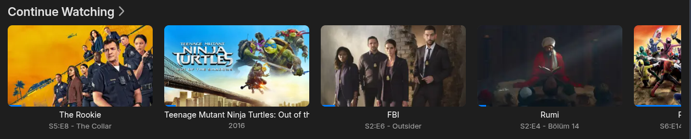 | 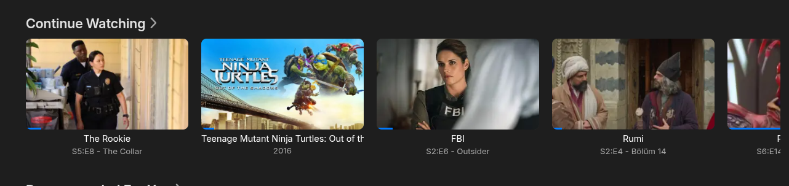 |

</details>

<details>
<summary><b>Landscape TV Thumbnails: Home Page</b></summary>

| Before | After |
|--------|-------|
| 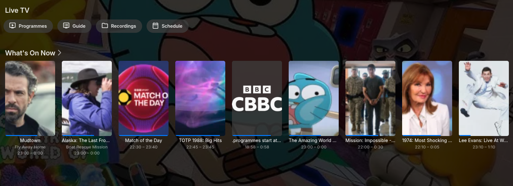 | 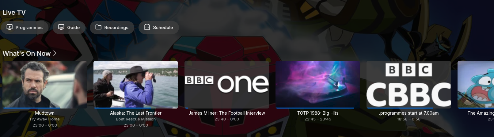 |

</details>

<details>
<summary><b>Landscape TV Thumbnails: Live TV Homepage / Other Lists</b></summary>

| Before | After |
|--------|-------|
| 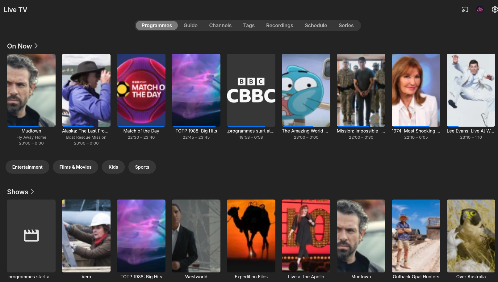 | 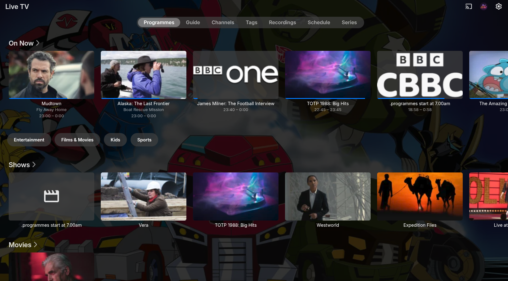 |

</details>

<details>
<summary><b>Landscape TV Thumbnails: Live TV OSD Info</b></summary>

| Before | After |
|--------|-------|
| 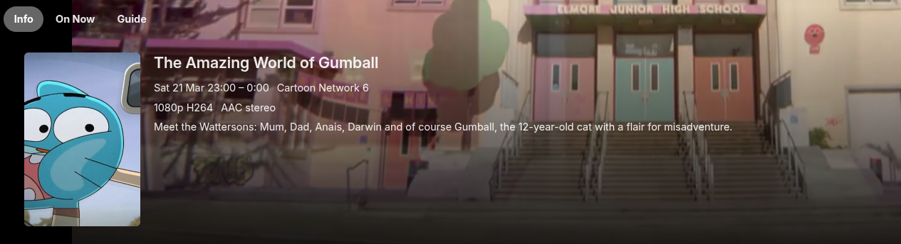 | 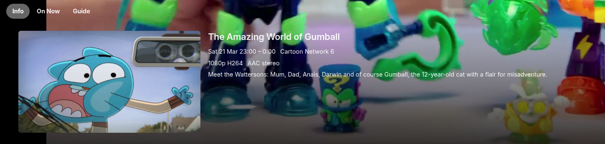 |
| 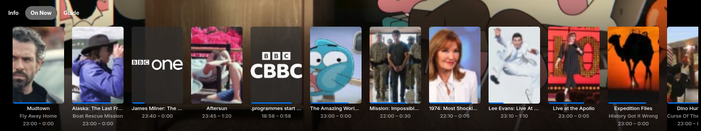 | 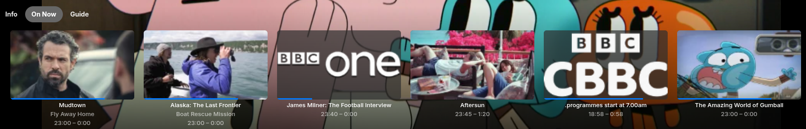 |

</details>

<details>
<summary><b>Landscape TV Thumbnails: TV Guide Item / Individual Item</b></summary>

| Before | After |
|--------|-------|
| 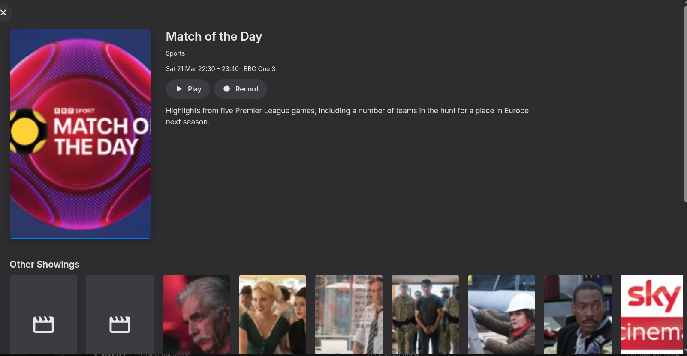 | 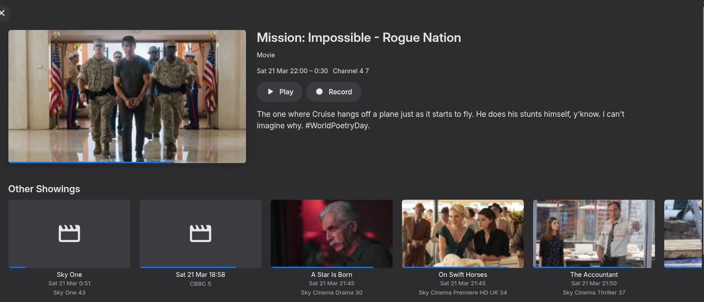 |

</details>

<details>
<summary><b>Landscape TV Thumbnails: TV Guide Channel Schedule Items</b></summary>

| Before | After |
|--------|-------|
| 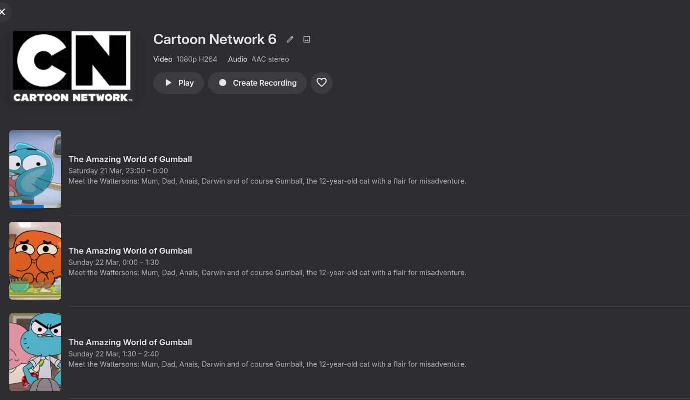 | 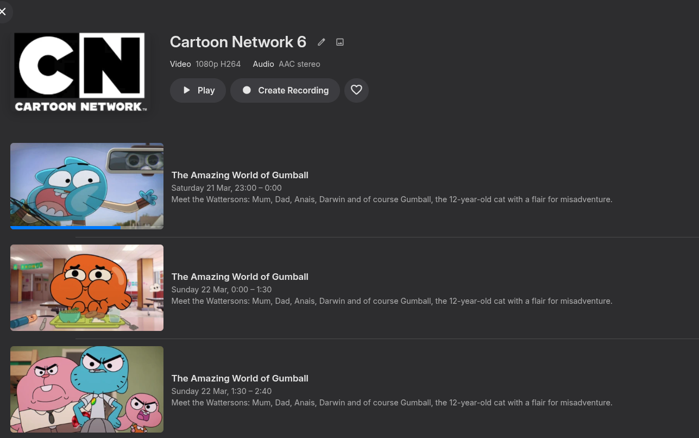 |

</details>